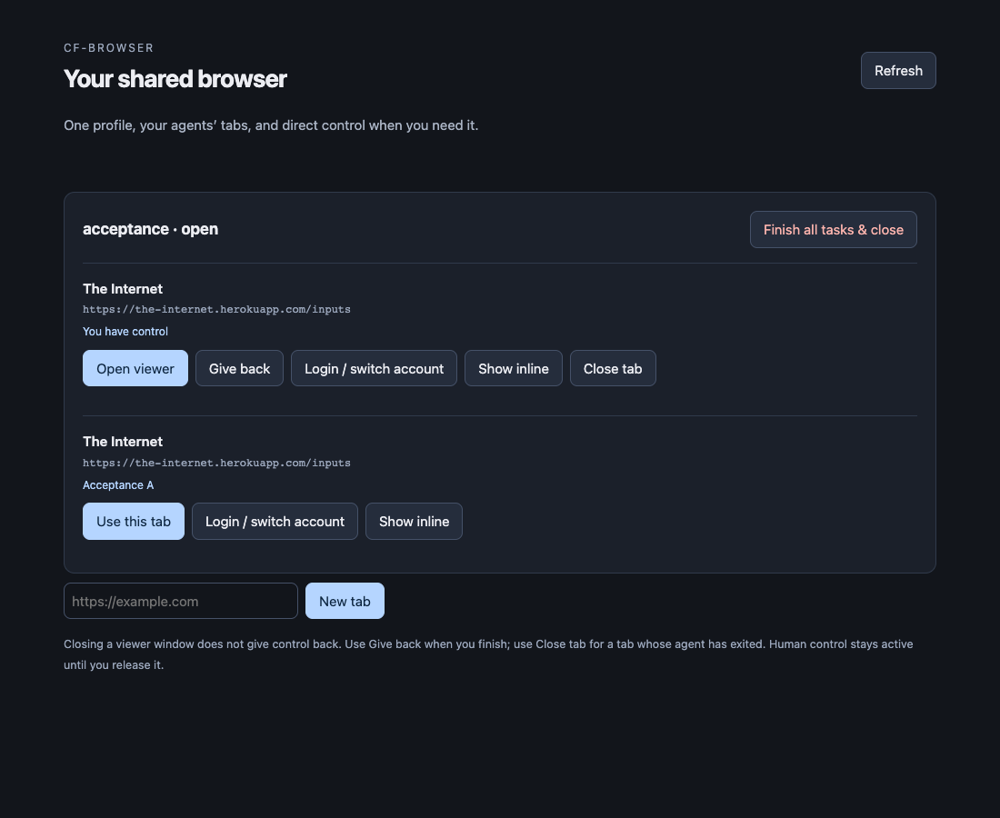

# Shared-browser acceptance evidence

Verified on October 27, 2026 against this revision. Historical October 22 evidence remains in [verified-facts.md](../verified-facts.md); it is not a pass for the new architecture. Tests use disposable profiles and synthetic values, never the user's saved login state.

## Automated contracts: passed

`npm run typecheck && npm run build && npm test`: **25 tests passed, zero skipped** on macOS with a real disposable Chromium process for the driver contract. CI also runs this suite on Ubuntu and macOS; CI results belong to the PR checks.

The tests cover two-client ownership and explicit transfer, independent tab execution, tab/identity/browser takeover, client exit, inactivity, checkpoint failure, corrupt profile state, legacy live writers, unconfirmed DELETE, interrupted creation, restart without action replay, interrupted-script termination, stale observations and screenshot geometry, dialog recovery, uploads, downloads, popup ownership, and racing finish/open and handoff/status calls. HTTP tests cover authentication, Host/Origin rejection and request deduplication. Stdio tests cover discovery and doctor without credentials. Static checks detect retired steering and hooks.

A clean launcher startup with `CFB_DEV=0` and a temporary empty home installed the production-only pinned driver and exposed tools/doctor without credentials. No local Chromium is installed or launched by the production path; local Chromium is solely a test dependency.

Manifest validation, plugin-kit integrity, repository validation, hook smoke tests, local Markdown links and secret scans are required before push. The generated `dist/server.mjs` is committed and CI checks build freshness.

## Live Cloudflare and viewer acceptance: passed

Run explicitly from `plugins/cf-browser/server`: `node scripts/live.mjs`. The script inherits credentials privately, creates an isolated temporary home, starts two real stdio SDK clients, and cleans only its own remote browsers.

- Both clients used one Cloudflare browser/default context and separate stable tabs.
- Semantic snapshots worked on the public Inputs fixture; cookies, localStorage and IndexedDB shared synthetic login values between tabs.
- Screenshot output arrived as native MCP image content. Activating the target before capture fixed background compositor stalls observed during validation. Only screenshot capture is serialized; semantic operations remain independent.
- Target-scoped interactive Live View blocked the owning agent while the other client's tab continued.
- The local control panel rendered ownership and opened the native viewer. Typing `31415` through that viewer changed the remote input, verified after release.
- The viewer's frame policy was `frame-ancestors *`; its canvas actually rendered in the local panel iframe. A separate named window remains available.
- Native structured handoff's Done returned control and checkpointed. Explicit manual release ended a pending handoff without asserting login success. The provider protocol schema exposed both the completion command and event.
- Finishing one client preserved the other. Finishing the last task checkpointed and confirmed remote closure; the harness also handles an honest `close_unconfirmed` state while reconciliation finishes.
- Reopening restored all three storage types, and the reopened remote browser also closed. Temporary test profiles were removed after confirmed cleanup.

## Actual host-model evaluation: blocked by authentication

`node scripts/agent-live.mjs` attempted a real Claude Code 2.1.307 model run with the current browse instructions and only this MCP server. It requested two public pages, a small input edit, visual verification and task completion. The host reported **OAuth session expired and could not be refreshed** before any tool call (zero browser operations). Cleanup confirmed no browser remained.

This is **not** a passing model evaluation. The harness uses the packaged browse text explicitly; automatic host skill selection, live Codex model behavior and the full [20-scenario agent evaluation](agent-evaluation.md) still need authenticated host runs. Runtime SDK clients are not substitutes for that evidence. No host authentication/configuration was changed.

## Scope of the evidence

Synthetic persistence is verified; every site's real SSO, MFA, passkey, bot challenge and account-switch behavior is not. Persistence covers cookies, localStorage and IndexedDB, not a complete Chrome disk profile or unsaved forms. Native viewer behavior was exercised on the current Cloudflare service, not guaranteed for all future service versions or networks.

Advanced Quick Actions/crawl/replay/WebMCP routes remain available through discovery and were adapted/validated statically; this revision did not rerun every live advanced-service scenario. Cancellation, outage and restart semantics have deterministic tests; deliberate production network faults were not injected into the user's account. Twenty simultaneous real agent models and long-duration soak behavior were not tested.
